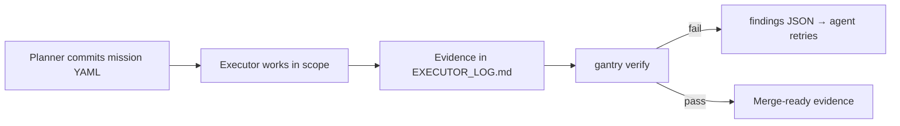

<p align="center">
  <a href="https://opengantry.ai"></a>
</p>

# OpenGantry

## Deterministic guardrails and verification for AI coding agents

OpenGantry keeps AI coding agents inside boundaries you declare and checks their work with the gates you already trust. It is the open-source `gantry` CLI: local-first, Git-native, vendor-neutral. Nothing runs in a hosted console.

> **Not [Gantry.io](https://gantry.io).** OpenGantry enforces in your repository and your CI; it is not a hosted observability dashboard. Docs: [opengantry.ai/docs](https://opengantry.ai/docs/).

## Start with the cage

No setup and no config. Check what any agent committed, whatever started it (a terminal agent, an IDE agent, or a cloud agent that opens pull requests):

```bash
npx -p @jeger-ai/opengantry gantry cage check --base origin/main
```

`cage check` fails with exit `3` when a commit in `base..HEAD` changes CI configs, `.env` files, hook files under an in-repository `core.hooksPath` (such as `.githooks/`), your manifest `forbidden_zones` or your `.cage.yaml` entries. Lockfile changes are listed without failing it. The rules come from the base commit, so a branch cannot loosen them, and every commit counts, so a secret committed and removed again still fails. Put it where every agent's work lands, the pull request:

```yaml
# .github/workflows/cage-check.yml
on: pull_request
jobs:
  cage-check:
    runs-on: ubuntu-latest
    steps:
      - uses: actions/checkout@v4
        with: { fetch-depth: 0 }
      - uses: actions/setup-node@v4
        with: { node-version: 24 }
      - run: npx -y -p @jeger-ai/opengantry gantry cage check --base ${{ github.event.pull_request.base.sha }}
```

While you work, **`gantry cage watch`** covers what never reaches a commit: a gitignored `.env`, `.git/config`, `.git/hooks`. Start it in its own terminal before the agent, and every change to a protected file becomes your decision:

```bash
npx -p @jeger-ai/opengantry gantry cage watch
# cage watch: .env changed (secrets, modified, sha256 3467a14afa0c). Keep it? [a]ccept / [r]eject; rejected in 20s
```

`a` keeps the change, `r` restores the file, and no answer within 20 seconds restores it too. Answers come only from the watch terminal, so run it in a plain terminal window, not inside tmux or screen. It watches files, not processes, so it covers IDE, desktop and terminal agents alike.

For agents your scripts start non-interactively, the **session cage** restores protected files while they run and refuses `git push` of them from inside the session:

```bash
npx @jeger-ai/opengantry-cage -- claude -p "…"
```

`gantry cage suggest --write` proposes `.cage.yaml` rules for migrations, infrastructure and key files; the file can only add protection. The check sees committed history only, the watch sees files on disk while it runs, and the session cage restores rather than blocks. Read [the cage docs](docs/cage/index.md) and [its limits](docs/cage/limits.md).

## Then govern agent work with missions

The cage protects a fixed set of paths. Missions add scope checked on every write, work approved before it starts, and evidence a reviewer can check in CI.



- **Scope before execution.** A mission declares the paths an agent may edit and the paths no one may touch, and a Planner commits it before any work starts.
- **Deterministic verification.** Gates are your shell commands (`npm test`, lint, type checks) with a pass or fail, not an LLM's opinion.
- **Structured retry input.** On failure, `gantry verify` returns `findings[]` with the file, line and a hint, so an agent can fix the problem instead of guessing from stderr.
- **Forensic trace.** Every mission ties to `[MSN-NNNN]` commits and verbatim gate output in `EXECUTOR_LOG.md`.
- **Any domain.** The same graph governs TypeScript import layers and brand or compliance copy.

How it fits together: [How OpenGantry works](docs/start/how-it-works.md).

## Install

Node.js 24 or newer:

```bash
npm install -g @jeger-ai/opengantry
gantry init --tutorial      # scaffold the substrate and walk through a first mission (~3 min)
```

Then [your first mission](docs/start/first-mission.md) and [wire your agent](docs/guides/agents.md): Cursor, Claude Code, Codex, OpenCode, Junie, Antigravity, Cline, Aider or OpenHands.

## gantry CLI

<a id="gantry-cli-mvp"></a>

| Goal | Commands |
|------|----------|
| Set up | `gantry init`, `gantry init --tutorial`, `gantry planner set "$(git config user.email)"`, `gantry doctor` |
| Cage | `gantry cage check --base <ref>`, `gantry cage watch`, `gantry cage -- <cmd>`, `gantry cage suggest --write`, `gantry cage policy --agent claude-code`, `gantry-cage read-guard` |
| Legislate | `gantry legislate "<intent>" --msn MSN-NNNN --skill-key <key> --gate-command "<cmd>"`, `gantry legislate --from-intent "<intent>" --msn MSN-NNNN` |
| Execute | `gantry mission pin <mission>`, `eval "$(gantry runtime env)"`, `gantry runtime exec --mission <file> -- <cmd>` |
| Verify | `gantry verify --mission <file>`, `gantry verify --contract [file] --base <ref>`, `--json`, `--format sarif\|junit`, `gantry adapt --from lights-on <plan>` |
| Inspect | `gantry doctor`, `gantry mission pin` |
| Perimeters | `gantry arch check`, `gantry perimeter --ci` |
| Organization | `gantry policy pull`, `gantry ledger verify`, `gantry deps check`, `gantry ledger list` |

`GANTRY_PLANNER_EMAILS` (comma-separated Git author emails) lists who may approve missions; `gantry planner set` records yours. `gantry mcp serve` exposes the same workflow to MCP clients. Every command takes `--help`.

## What OpenGantry is not

- **Not an agent.** It does not chat, plan features or open pull requests by itself.
- **Not a hosted console.** Gates and cages run on your machine and in your CI; verify uploads no source.
- **Not an LLM judge for merge.** Gates stay deterministic: your commands, their exit codes.

## Documentation

| Start here | |
|------------|---|
| [The cage](docs/cage/index.md) | `cage check`, `cage watch` and the session cage |
| [Read guard](docs/cage/read-guard.md) | Keep `.env`, git credentials, SSH keys and cloud credentials out of Claude Code's and Cursor's context |
| [Get started](docs/start/how-it-works.md) | How it works, install, first mission |
| [Guides](docs/guides/agents.md) | Agents, CI, content, regulated teams, org control plane, troubleshooting |
| [Verify without missions](docs/guides/verify-contract.md) | `gantry verify --contract` or `npx @jeger-ai/opengantry-verify`: one `verify.yaml` decides whether a change may land |
| [Concepts](docs/concepts/missions.md) | Missions, scope, perimeters, verify, trace evidence, enforcement boundary |
| [Reference](docs/reference/mcp-tools.md) | MCP tools, session variables, metrics, break-glass, [release notes](docs/reference/release-notes.md) |
| [Manifesto](docs/MANIFESTO.md) | Why: the post-PR software factory, who owns which law, and the ladder from cage to verify to the org plane |

All docs: [`docs/index.md`](docs/index.md), also at [opengantry.ai/docs](https://opengantry.ai/docs/). Upgrade notes: [`docs/CHANGELOG.md`](docs/CHANGELOG.md). Security: [`docs/SECURITY.md`](docs/SECURITY.md). Contributing: [`docs/DEVELOPMENT.md`](docs/DEVELOPMENT.md).

Apache-2.0. See [`LICENSE`](LICENSE) and [`NOTICE`](NOTICE).
