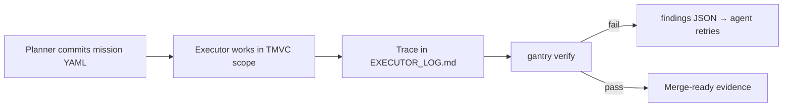

<p align="center">
  <a href="https://opengantry.ai"></a>
</p>

# OpenGantry

## Deterministic CI/CD and Governance for Autonomous Agents

OpenGantry is a local verification kernel that wraps AI agents in a strict execution cage. It scopes edits, enforces architectural boundaries, and runs your traditional SDLC gates before allowing a single line of code to be merged.

> **Not [Gantry.io](https://gantry.io)?** OpenGantry is the open-source **`gantry` CLI** for local-first, Git-native agent enforcement in your repository, not a hosted observability dashboard. Product home: [opengantry.ai](https://opengantry.ai).

### The Verification Pipeline

* **Scope Enforcement (TMVC):** Restrict agent file mutations to explicitly authorized directories and paths.
* **Architectural Boundaries:** Prevent unauthorized public exports and structural violations via `TARGET_ARCHITECTURE.yaml` import layers and perimeter checks.
* **Execution Gates & Remediation:** Run standard build and test commands within the agent harness. If a gate fails, OpenGantry returns a deterministic JSON `findings[]` payload, allowing the agent to self-correct without human intervention.

Deep dive: [`docs/SECURITY.md`](docs/SECURITY.md) · [`docs/FEATURES.md`](docs/FEATURES.md) · [opengantry.ai](https://opengantry.ai)

---

## In plain English

OpenGantry uses product terms that sound abstract. Here is what the CLI actually runs:

| Term you will see | What it actually is |
|-------------------|---------------------|
| **Contract** | Mission YAML under `.gitagent/missions/` — allowed paths, forbidden paths, and a required `gate_command` (shell) |
| **Legislate** | `gantry legislate` / Mission Architect writes that YAML; a Planner commit locks it in Git before work |
| **Governance** | Hooks + `gantry verify` that fail closed if scope or gates are violated — not a process committee |
| **Verdict** | Deterministic pass/fail from shell gates + trace checks; on fail, a `findings[]` JSON envelope |

**"Contract" is not design-by-contract (DbC).** It is not pre/post conditions in source code. It is the Git-locked work order that tells the agent where it may edit and which shell command must pass before merge.

---

## Why not just TDD and CI?

You already have `npm test` and GitHub Actions. OpenGantry does not replace them — it makes them usable when an **AI agent** runs the graph.

| Who runs the graph | What happens on failure |
|-------------------|-------------------------|
| **Human developer** | Reads stderr, parses the stack trace, rewrites code |
| **AI agent + raw TDD/CI** | Chokes on unstructured stderr, hallucinates fixes, spins on retry edges — a senior still babysits |
| **AI agent + OpenGantry** | Same gates you already trust; `gantry context-feed --json` returns compact `findings[]` with `offending_file`, line, and hint |

| Already have | Still missing for autonomous agents | OpenGantry adds |
|--------------|-------------------------------------|-----------------|
| `npm test` / GH Actions | Structured failure for model retry | `findings[]` envelope |
| PR CI | Declared edit blast radius | TMVC + forbidden zones in mission YAML |
| Code review | Proof the agent stayed in scope | Git mission + `EXECUTOR_LOG.md` quotes |

---

## Vision

North Star: [The Post-PR Software Factory](docs/MANIFESTO.md) ([opengantry.ai/docs/manifesto/](https://opengantry.ai/docs/manifesto/)).

Most AI agent tooling optimizes for *speed of generation*. OpenGantry optimizes for **trust at scale**:

- **Scope before execution:** no silent edits to governance files, no wandering outside approved paths
- **Deterministic verification:** gates are shell commands with pass/fail outcomes, not LLM opinions
- **Forensic trace:** every mission ties to `[MSN-XXXX]` commits and verbatim quotes in `EXECUTOR_LOG.md`
- **Domain-agnostic:** the same graph governs TypeScript imports *and* brand/compliance copy

The long-term bet: external executors (Cursor agents, Hermes, CI bots) do the work; **OpenGantry owns the mission YAML and the verify output**. That separation is what makes agentic delivery auditable in regulated or security-sensitive environments.

---

## What problem it solves

Without governance glue, agent-assisted repos tend toward:

| Problem | OpenGantry answer |
|---------|-------------------|
| Agents edit `.gitagent/` or manifest silently | Git hooks + `gantry verify` fail closed |
| "It passed locally" with no proof | `gate_command` + trace quotes verifiers must cite |
| Architecture drift | `TARGET_ARCHITECTURE.yaml` + `gantry arch check` / `gantry perimeter check` |
| Opaque failures for retry edges | `findings[]` JSON envelope (`offending_file`, line, hint); no terminal log parsing |
| One-off policy per repo | `gantry init` scaffolds the same GXT substrate everywhere |
| No org-wide floor or audit chain | `gantry policy` (tighten-only bundle), `gantry ledger` (`refs/gxt/ledger`), `depends_on` (ADR-0042–0044) |

---

## The core graph (GXT)

Everything revolves around a **mission**:



**Roles:**

- **Planner:** human (or Mission Architect in chat) commits mission YAML via `gantry legislate` before execution
- **Executor:** agent or developer edits within TMVC roots; forbidden zones respected
- **Verifier:** `gantry verify` checks gate output and trace mapping

**Key artifacts in your repo:**

| File | Role |
|------|------|
| `.gitagent/missions/MSN-XXXX.yaml` | Scope, `gate_command`, trace rows |
| `.gitagent/foreman/MANIFEST.json` | Skill routing, TMVC roots, risk tiers |
| `.gitagent/planner/RULES.md` | Governance law (Tier-3, Planner-only) |
| `EXECUTOR_LOG.md` | Verbatim PASS quotes for verify |
| `TARGET_ARCHITECTURE.yaml` | Perimeter rules (imports or regex) |

---

## Three phases, any domain

OpenGantry is a **domain-neutral verify graph**, not just a TypeScript linter:

| Phase | Command | Output |
|-------|---------|--------|
| **Context ingestion** | `gantry init --discover --domain code\|content` | `.gitagent/discovery-proposal.json` |
| **Rules of engagement** | `gantry blueprint --domain code\|content` | `ARCHITECTURE.md`, `TARGET_ARCHITECTURE.yaml`, `verification_plan.json` |
| **Standardized audit API** | `gantry verify --json` | `findings[]` failure envelope |

### Built-in domain adapters

| Domain | Corpus | Enforcement |
|--------|--------|-------------|
| `code` | `.ts`, `.js`, … | Import layers, forbidden specifiers |
| `content` | `.md`, `.html`, `.txt`, … | `forbid_pattern`, `require_pattern` regex |

List them: `gantry domains`

**Binary enforcement:** pass/fail only — no LLM opinions at the gate. Content discovery uses exact-match boilerplate only; it does not infer "dominant terminology" from statistics that would flip on unrelated edits.

See [`docs/DOMAINS.md`](docs/DOMAINS.md) for adapter details and [`docs/AGENT-GRAPH.md`](docs/AGENT-GRAPH.md) for external executor integration.

---

## Try it in 60 seconds: `gantry cage`

No setup, and nothing to change about how you start your agent. Whatever wrote the commits (a terminal agent, an IDE agent or a cloud agent that opens pull requests), check them:

```bash
npx -p @jeger-ai/opengantry gantry cage check --base origin/main
# installed (npm install -g @jeger-ai/opengantry): gantry cage check --base origin/main
```

`cage check` looks at every commit in `base..HEAD` and fails (exit `3`) when one of them changes a protected path: CI configs, `.env` / `.env.*`, a committed `core.hooksPath`, your manifest `forbidden_zones` or your `.cage.yaml` entries. Lockfile changes are listed but do not fail it. A secret committed and deleted again still counts, because it is in the history you push. It cannot see what never gets committed: an edit to a gitignored `.env` or to `.git/hooks` stays invisible to it. The rules come from the base commit, so a branch cannot loosen the check it is held to by editing `.cage.yaml` or the manifest; the edit itself is flagged. `--json` emits a digest-only report (paths and rules, never file contents).

Put it where every agent's work lands, the pull request:

```yaml
# .github/workflows/cage-check.yml
on: pull_request
jobs:
  cage-check:
    runs-on: ubuntu-latest
    steps:
      - uses: actions/checkout@v4
        with: { fetch-depth: 0 }
      - uses: actions/setup-node@v4
        with: { node-version: 24 }
      - run: npx -y -p @jeger-ai/opengantry gantry cage check --base ${{ github.event.pull_request.base.sha }}
```

**While you work: `gantry cage watch`.** The files agents tamper with locally, a gitignored `.env`, `.git/config`, `.git/hooks`, never reach a commit. Start a watch in its own terminal before the agent, and every change to a protected file becomes your decision:

```bash
gantry cage watch
# cage watch: .env changed (secrets, modified, sha256 3467a14afa0c). Keep it? [a]ccept / [r]eject; rejected in 20s
```

You get a terminal bell and a desktop notification; you answer in the watch terminal only, where an agent cannot type (keep it out of tmux or screen, whose `send-keys` could). `a` keeps the change, `r` restores the file, and no answer within 20 seconds (`--decision-timeout <s>`) restores it too. Accept applies only to the content the prompt showed. A path rejected three times is restored without asking for the rest of the session. Lockfile changes are logged without a prompt. Ctrl-C restores anything still pending and prints a report (`--json` for `gantry.cage-watch.v1`; exit `3` if anything was restored). It covers every agent, IDE, desktop or terminal, because it watches files, not processes; it cannot stop reads of `.env`, so deny those in your agent tool's permissions.

To protect more of your own repo (migrations, infrastructure, key files), let cage propose rules, review them, and commit `.cage.yaml`:

```bash
gantry cage suggest --write      # writes .cage.yaml.suggested; review it, keep what you want as .cage.yaml, commit
```

`.cage.yaml` can only add protection; it can never switch a built-in rule off. A top-level `mode: report` in it is a default for your own entries, not for the built-ins.

**Scripted agent runs: the session cage.** When a script or CI job starts an agent non-interactively, wrap it, and cage restores protected files while it runs:

```bash
npx @jeger-ai/opengantry-cage -- claude -p "…"
# full package: gantry cage -- <cmd>, gantry-cage -- <cmd>
```

`@jeger-ai/opengantry-cage` is the slim standalone build of the session cage (same sources, `commander` as the only runtime dependency, no native modules, no install scripts); `cage check` and `cage suggest` live in the full package. About once a second the session cage restores changes to CI configs, `.env` / `.env.*`, `.git/config`, `.git/hooks/` (and `core.hooksPath`), manifest `forbidden_zones` and `.cage.yaml` entries; lockfile changes are listed but kept. A `git push` from inside the session is refused when the outgoing commits touch those paths. At the end it prints one report and exits `3` if anything was restored (otherwise the command's own exit code). A path the command keeps rewriting halts it after the third restore (exit `4`; `--contest-limit <n>`, or `contest_limit:` in `.cage.yaml`, `0` never halts), and `--allow-override <path>` reports one path instead of restoring it for a run, always announced.

The session cage restores; it does not block. A change can be committed in the second before the next check, `git push --no-verify` skips the push guard, and reads, network calls and writes outside the protected set are not seen. `cage check` sees committed history only; `cage watch` sees files on disk while it runs. For scope enforced on every write, use missions (below). Details: [`docs/FEATURES.md`](docs/FEATURES.md#zero-config-cage-gantry-cage) · why check and watch come first: [ADR-0050](.gitagent/out-of-scope/ADR-0050-cage-diff-check.md).

---

## Feature tour: what to try first

### 1. Bootstrap a repo

```bash
npm install -g @jeger-ai/opengantry
gantry init --tutorial
```

Scaffolds `.gitagent/`, hooks, manifest, and walks you through the first mission graph.

### 2. Fast-path discovery

```bash
gantry init --discover --domain code      # scan TS/JS imports
gantry init --discover --domain content   # scan markdown corpora
```

Emits a proposal with evidence-anchored conventions and anomalies (`file:line` snippets). Nothing becomes law until a human confirms or runs blueprint.

**Speed:** the discovery scanner uses streaming regex per file, not a whole-repo AST. It is budgeted to finish a **5,000-file monorepo in under five seconds** (pinned in CI). OpenGantry ingests repository context in seconds without loading the tree into a heavy compiler graph or spiking RAM. Enterprise teams do not have to wait minutes for a governance tool to "understand" the repo before the agent graph starts.

### 3. Blueprint: lock rules and gate commands

```bash
gantry blueprint --domain content --yes
```

Produces three artifacts:

- **`ARCHITECTURE.md`:** human-readable decisions with evidence links
- **`TARGET_ARCHITECTURE.yaml`:** machine-checkable rules (schema 0.3.0 for content)
- **`.gitagent/verification_plan.json`:** `gate_commands` and `required_skills` gaps

The executor agent reads `required_skills` and builds missing tooling *before* coding.

### 4. Perimeter enforcement

```bash
gantry arch check              # code: import/layer rules
gantry perimeter check         # domain-neutral alias (same engine)
```

For content, rules look like:

```yaml
forbid_pattern: "(?i)cures cancer"
require_pattern: "These statements have not been evaluated by the FDA"
```

Violations carry `file` and `line` for the failure envelope.

### 5. Mission + verify

```bash
gantry legislate --from-intent "add feature X" --msn MSN-0042 --skill-key gantry
# or: gantry contract propose "add feature X" --skill-key gantry
# Planner commits [MSN-0042] mission YAML (seals contract + contract_sha256)
eval "$(gantry runtime env --mission .gitagent/missions/MSN-0042.yaml)"
# ... do work, append trace to EXECUTOR_LOG.md ...
gantry verify --mission .gitagent/missions/MSN-0042.yaml --json
```

On failure, external agents ingest `findings[]`:

```json
{
  "failed_gate": "arch",
  "offending_file": "content/ad-bad.md",
  "line": 3,
  "severity": "error",
  "resolution_hint": "..."
}
```

**v3.8.3:** the standalone cage command is `gantry-cage` (`opengantry-cage` stays as an alias in the full package), zod moves to 4 inside the MCP server, and both packages are published through npm trusted publishing with provenance. See the [upgrade notes](docs/CHANGELOG.md#upgrade-notes).

**v3.8.2:** `gantry cage` survives being stopped and refuses what it cannot restore: SIGTERM or SIGHUP on cage terminates the agent's whole process tree and restores, a `kill -9` on cage is recovered by the next run from a hash-verified journal, and a protected file over the snapshot cap stops cage with exit `2` instead of running unprotected ([ADR-0048](.gitagent/out-of-scope/ADR-0048-cage-trust-model.md) decision 8). The cage also ships on its own: `npx @jeger-ai/opengantry-cage -- claude`. See the [upgrade notes](docs/CHANGELOG.md#upgrade-notes) for the two behaviour changes.

**v3.8.1:** `gantry cage` terminates an agent that keeps rewriting a protected path (exit `4`; `--contest-limit <n>` or `.cage.yaml` `contest_limit:`, `0` for the old contested-at-exit behaviour), and `.cage.yaml` gains a top-level `mode:` default for its own entries ([ADR-0048](.gitagent/out-of-scope/ADR-0048-cage-trust-model.md) decision 7). See [Try it in 60 seconds](#try-it-in-60-seconds-gantry-cage).

**v3.8.0:** per-project cage rules: `.cage.yaml` adds paths and globs to the protected set (additive only, self-protected, fail closed), `gantry cage suggest` proposes them for review, and `--allow-override <path>` reports instead of restoring one path for a run, always announced ([ADR-0048](.gitagent/out-of-scope/ADR-0048-cage-trust-model.md)). See [Try it in 60 seconds](#try-it-in-60-seconds-gantry-cage).

**v3.7.1:** `gantry cage` restores protected files live during interactive agent sessions (default; `--no-watch` for exit-only) and refuses `git push` of protected paths from inside the session. See [Try it in 60 seconds](#try-it-in-60-seconds-gantry-cage).

**v3.7.0:** zero-config `gantry cage -- <cmd>` (and `npx -p @jeger-ai/opengantry opengantry-cage -- <cmd>`) restores CI configs, `.env*`, git hooks/config and manifest forbidden zones after a one-shot agent run, reports lockfile changes, and exits 3 on tampering. See [Try it in 60 seconds](#try-it-in-60-seconds-gantry-cage).

**v3.6.0:** `gate_adapter: tsc|eslint` fails closed on chained `gate_command`s (`GXT_GATE_ADAPTER_MISCONFIG`). `gantry hooks install` arms the tracked pre-commit hook so `gantry tmvc guard --strict` blocks commits outside the pinned mission. Optional local sqlite-vec contract drift index (`gantry contract embed`, `legislate --from-intent --embedding-file`). See [`docs/CHANGELOG.md`](docs/CHANGELOG.md) upgrade notes.

**v3.5.0:** Cursor MCP uses a byte-identical `./scripts/mcp-launcher.sh` (no mcp.json parity exemption). `gantry verify --format sarif|junit` writes the document only on stdout and diagnostics on stderr ([`docs/CI.md`](docs/CI.md)). `gantry contract preflight` is advisory and fail-open ([ADR-0046](.gitagent/out-of-scope/ADR-0046-experimental-contract-preflight.md)).

**Mission contracts (v3.4.0):** Planner-sealed inline `contract` + `contract_sha256` on the mission YAML (tighten-only TMVC / forbidden / import cage). `gantry contract propose|check|show`, `gantry legislate --from-intent`, MCP `gxt_propose_contract`. Verify runs a `contract` phase after git-proof; `gantry runtime env` exports `GXT_ALLOWED_IMPORTS` / `GXT_BANNED_IMPORTS`; `runtime exec` reports `contract_violation` ([ADR-0045](.gitagent/out-of-scope/ADR-0045-mission-contracts.md)).

**Org control plane (v3.3.0):** pin a signed org policy repo with `.gitagent/foreman/POLICY.pointer.json` and `gantry policy pull` (doctor/verify stay offline). Enable `ledger.mode: local` to append digest-only entries to `refs/gxt/ledger` (`gantry ledger verify` / `export --format soc2-pack`). Cross-repo gates use mission `depends_on[]` plus `gantry deps fetch` before verify ([ADR-0042](.gitagent/out-of-scope/ADR-0042-org-policy-bundle.md), [ADR-0043](.gitagent/out-of-scope/ADR-0043-compliance-ledger-git-ref.md), [ADR-0044](.gitagent/out-of-scope/ADR-0044-cross-repo-mission-dependencies.md)). Receipt schema stays 0.2.0.

**Kernel (v3.3.0 breaking):** `import { verifyMission } from "@jeger-ai/opengantry/kernel"` now returns a Promise — always `await`. `verifyMissionAsync` is a deprecated alias (`DeprecationWarning` `GXT_DEP_VERIFY_MISSION_ASYNC`, removed in 4.0). CLI `--json-out` is unchanged.

**Tool-native findings:** set `gate_adapter: eslint` (gate must run `eslint --format json`, e.g. `npm run lint:json`) or `gate_adapter: tsc` (plain `tsc` diagnostics, e.g. `npx tsc --noEmit --pretty false`) in the mission YAML and `gantry verify` maps each lint or type error to its own finding with `offending_file`, `line`, columns, and `rule_id`. Routing is explicit — never inferred from the command string (ADR-0041). Do not concatenate `tsc` and `eslint` in one `gate_command`. Typed adapters (`tsc`, `eslint`) **fail closed** at mission validate / verify start if `gate_command` uses unquoted `&&`, `||`, `;`, or line break (`GXT_GATE_ADAPTER_MISCONFIG`) — wrap sequences in a script or use `gate_adapter: generic`. The default `generic` adapter keeps exit-code plus `gate_success_substring` semantics.

```yaml
gate_adapter: eslint
gate_command: "npm run lint:json"   # eslint --format json …
# gate_adapter: tsc
# gate_command: "npx tsc --noEmit --pretty false"
```

**No terminal vomit:** agents do not scrape unstructured stderr or guess which line failed. The `findings[]` envelope is a **predictable, structured audit API** built for autonomous retry edges: each item names the gate, `offending_file`, line, severity, and a resolution hint. Use `gantry context-feed --json` for compact model re-entry; read `gate_log_path` on disk for full stack traces. Humans can run **`gantry report`** — a localhost overview of repo metrics, mission history, and the last verify (drill-down at `/verify`). Same payload on `--json`, SARIF, and MCP `gxt_verify`.

### 6. Content governance example

See [`examples/content-governance/`](examples/content-governance/). Ad copy with seeded violations (forbidden claim, missing disclaimer, wrong brand hex). Same graph as code; different adapter.

### 7. IDE integration

- **Cursor MCP:** `gxt_draft_legislation`, `gxt_verify`, `gxt_pin_mission`
- **Hooks:** session start loads pinned mission; shell guards block unscoped substrate writes
- Details: [`docs/INTEGRATIONS.md`](docs/INTEGRATIONS.md)

---

## What OpenGantry is *not*

- **Not an agent:** it does not chat, plan features, or generate PRs by itself
- **Not Gantry.io:** no hosted observability dashboard; everything runs in your repo
- **Not an LLM judge for merge:** gates stay deterministic; optional LLM evidence is committed separately via `gantry scan`

---

## Mental model for adopters

```
OpenGantry = scoped work order + shell gates + structured verify output
Executor agent = worker (Cursor, Hermes, human dev)
```

You adopt OpenGantry when agent velocity is valuable but **unreviewed scope creep, silent governance edits, or unverifiable "it works" claims** are unacceptable.

---

## Documentation map {#documentation-map-start-here}

Full doc index: [`docs/index.md`](docs/index.md) — organized by **how**, **what**, and **why**.

## Where to go next

| Goal | Doc |
|------|-----|
| All documentation | [`docs/index.md`](docs/index.md) |
| What it helps with | [`docs/USE-CASES.md`](docs/USE-CASES.md) |
| Why features exist | [`docs/FEATURES.md`](docs/FEATURES.md) |
| Adoption runbook | [`docs/ADOPTION.md`](docs/ADOPTION.md) |
| Release history | [`docs/CHANGELOG.md`](docs/CHANGELOG.md) |
| Domain adapters | [`docs/DOMAINS.md`](docs/DOMAINS.md) |
| External agent integration | [`docs/AGENT-GRAPH.md`](docs/AGENT-GRAPH.md) |
| Contributing / dogfooding this repo | [`docs/DEVELOPMENT.md`](docs/DEVELOPMENT.md) |
| Content walkthrough | [`examples/content-governance/`](examples/content-governance/) |
