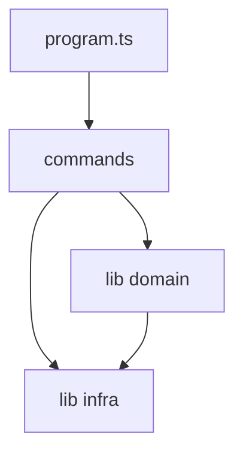

# gantry CLI architecture

Layered layout for [`src/cli/`](../src/cli/). Agents locate this file via [`.gitagent/ARCHITECTURE.pointer.json`](../.gitagent/ARCHITECTURE.pointer.json) (`kind: file`). Dependencies flow **downward only** (higher layers may import lower; never the reverse).

## Layers

| Layer | Paths | Responsibility |
|-------|--------|----------------|
| **core** (package) | `packages/core/src/**` | pure domain: error codes, `GantryUserError`, canonical JSON, path globs, POSIX path helpers, manifest shape, constants; `node:path` only, no fs, child_process, os or net |
| **git** (package) | `packages/git/src/**` | the single git adapter (`gitRun`, staged index); imports core only |
| **cage** (package) | `packages/cage/src/**` | the cage runtime: check, watch, session, suggest, push guard; imports core and git only |
| **CLI delivery** | `src/cli/index.ts`, `src/cli/program*.ts`, `src/cli/commands/**` | argv, stdin, exit codes, human output |
| **Application** | `*orchestrator*.ts`, `commands/*` orchestration | compose domain steps into use-cases |
| **Domain** | `mission-*.ts`, `trace.ts`, `triage-logic.ts`, `git-proof.ts`, `gate.ts`, `manifest.ts`, … | policy and pure rules |
| **Infrastructure** | `git-repo.ts`, `git.ts`, `runtime-exec-process.ts` | git, subprocess, FS |
| **Governance surface** | `.githooks/`, `scripts/`, `.github/workflows/` | shell out to `gantry`; no duplicated policy |

## Packages (ADR-0052 step 2)

`packages/core`, `packages/git` and `packages/cage` are packages in this repository with their own `package.json` (private), `tsconfig.json` and `tests/`. They are not npm workspaces: nothing resolves them through `node_modules`, so the lockfile does not list them. `tsc -b` builds them first (project references) into `dist/packages/<name>/src/`, and every importer reaches them through the root `package.json` `imports` field: `#core/<module>.js`, `#git/<module>.js` and `#cage/<module>.js`. That map resolves identically in the checkout and in the published tarball, so nothing is published separately and the slim cage bundle inlines them. Inside a package use relative imports; `packages/git` resolves `#core/*` through its `tsconfig.json` `paths` (a package `imports` target must stay inside its own package). The old paths under `src/cli/lib` are re-export facades until step 3 migrates the importers.

## Import rules (enforced in CI for changed files)

1. `src/cli/lib/**` MUST NOT import from `src/cli/commands/**`.
1. `packages/core/src/**` MUST NOT import `node:fs`, `node:child_process`, `node:os`, `node:net` or `node:http`, nor any module of the git, lib or command layers; `packages/git/src/**` MUST NOT import the lib or command layers; `packages/cage/src/**` MUST NOT import the lib, command or delivery layers (`TARGET_ARCHITECTURE.yaml` RULE-CORE-*, RULE-GIT-*, RULE-CAGE-*).
2. `src/cli/commands/**` MUST NOT import `runtime-exec-process.ts` directly (use `runtime-exec.js`).
3. Domain modules SHOULD NOT import `commander`.
4. Hooks and shell scripts MUST NOT reimplement MSN/git-proof logic; call `gantry`.

## Complexity budgets (changed `.ts` only)

| Rule | Production `src/cli` | Tests `src/cli/tests` |
|------|----------------------|---------------------|
| Max file lines | 450 | 900 |
| Max function lines | 80 | 120 |
| ESLint complexity | 20 | 25 |

Grandfathered paths (full-file exempt until refactored) live in [`.gxt-quality-baseline.json`](../.gxt-quality-baseline.json).

## Definition of done

OpenGantry contributors use the **full GXT stack** — see [`docs/DEVELOPMENT.md`](DEVELOPMENT.md).

- `npm run validate` (build, `gantry check`, tests, doctor, changed-code, MSN subjects)
- Mission + Planner `[MSN-…]` commit when GXT or CLI behavior changes
- `gantry verify --mission …` with matching `EXECUTOR_LOG.md` trace
- No new duplicate git spawn helpers (use `gitRun` from [`git/git.ts`](../src/cli/lib/git/git.ts))
