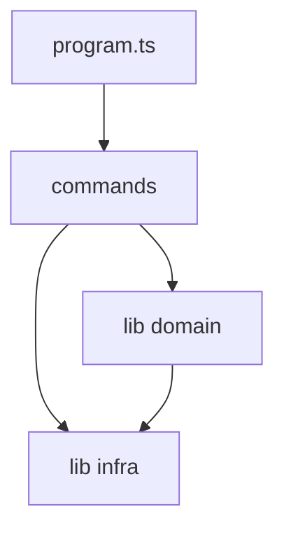

# gantry CLI architecture

Layered layout for [`src/cli/`](../src/cli/). Agents locate this file via [`.gitagent/ARCHITECTURE.pointer.yaml`](../.gitagent/ARCHITECTURE.pointer.yaml) (`kind: file`). Dependencies flow **downward only** (higher layers may import lower; never the reverse).

## Layers

| Layer | Paths | Responsibility |
|-------|--------|----------------|
| **core** (package) | `packages/core/src/**` | pure domain: the law model (`Law`, `tighten`, `classifyPath`, `isProtectedPath`, `ChangeSet`, `evaluatePaths`, `evaluateImportSite`, `ArchLaw`), the import scanner and specifier classifier, the run record and trusted-automation evaluators, the mission, contract, interrogation, trace-status, gate-adapter and config types, the zod schemas of the mission file, the org policy bundle and the KPI report (the YAML JSON-Schema files are generated from them), error codes, `GantryUserError`, canonical JSON, path globs, POSIX path helpers, manifest shape, constants; `node:path` only, no fs, child_process, os or net |
| **git** (package) | `packages/git/src/**` | the single git adapter (`gitRun`, staged index); imports core only |
| **cage** (package) | `packages/cage/src/**` | the cage runtime: check, watch, session, suggest, push guard; imports core and git only |
| **plane** (package) | `packages/plane/src/**` | the org plane: policy pointer, bundle and floor, ledger chain and append, cross-repository dependency checks, attestation receipts, signing and attribution; imports core and git only; identity, config and logging come in as parameters |
| **CLI delivery** | `src/cli/index.ts`, `src/cli/program*.ts`, `src/cli/commands/**` | argv, stdin, exit codes, human output |
| **Application** | `*orchestrator*.ts`, `commands/*` orchestration | compose domain steps into use-cases |
| **Domain** | `mission-*.ts`, `trace.ts`, `triage-logic.ts`, `git-proof.ts`, `gate.ts`, `manifest.ts`, … | policy and pure rules |
| **Infrastructure** | `git-repo.ts`, `git.ts`, `runtime-exec-process.ts` | git, subprocess, FS |
| **Governance surface** | `.githooks/`, `scripts/`, `.github/workflows/` | shell out to `gantry`; no duplicated policy |

## Packages (ADR-0052 step 2)

`packages/core`, `packages/git`, `packages/cage`, `packages/plane`, `packages/verify` and `packages/missions` are packages in this repository with their own `package.json` (private), `tsconfig.json` and `tests/`. They are not npm workspaces: nothing resolves them through `node_modules`, so the lockfile does not list them. `tsc -b` builds them first (project references) into `dist/packages/<name>/src/`, and every importer reaches them through the root `package.json` `imports` field: `#core/<module>.js`, `#git/<module>.js`, `#cage/<module>.js`, `#plane/<module>.js`, `#verify/<module>.js` and `#missions/<module>.js`. That map resolves identically in the checkout and in the published tarball, so nothing is published separately and the slim cage bundle inlines them. Inside a package use relative imports; a package resolves the packages below it through its `tsconfig.json` `paths` (a package `imports` target must stay inside its own package). Every importer names the package module directly; there are no re-export facades (ADR-0054). `src/cli` is delivery only: entries, programs, commands and the support layer grouped by role (`output`, `mcp`, `doctor`, `report`, `init`, `flows`).

## One law, one evaluator (ADR-0052 A2, A3)

Every question of the form "may this change touch this path" is answered by `judgePath` in `packages/core/src/path-law.ts` (ADR-0053): a `PathLaw` holds areas and a rule table with effects `deny`, `planner` and `report`, and `tightenPathLaw` composes levels so nothing widens. The cage plan, the mission scope (`scopePathLaw` in `packages/missions/src/tmvc-path.ts`), the perimeter, the staged guard, the MCP write guard and standalone verify each build a path law and judge with it. Imports are judged by `packages/core/src/law.ts`: `evaluateImportSite` (the contract's banned, unlisted, dynamic and scope-escape kinds) and, for `TARGET_ARCHITECTURE.yaml`, `ArchLaw` with `layerForFile`, `evaluateLayerImport` and `evaluatePatternRules`; the import scanner and the specifier classifier are core modules, and the contract scan and `gantry arch check` only walk files, resolve specifiers and call core. A new path or import check is a new law loader, not a new matcher.

## Import rules (enforced in CI for changed files)

1. The CLI's support modules (`src/cli/output`, `mcp`, `doctor`, `report`, `init`, `flows`; layer `lib`) MUST NOT import from `src/cli/commands/**`.
1. `packages/core/src/**` MUST NOT import `node:fs`, `node:child_process`, `node:os`, `node:net` or `node:http`, nor any module of the git, lib or command layers; `packages/git/src/**` MUST NOT import the lib or command layers; `packages/cage/src/**` MUST NOT import the lib, command or delivery layers; `packages/plane/src/**` MUST NOT import the cage, missions, lib, command or delivery layers; `packages/verify/src/**` MUST NOT import cage, plane, missions, lib, command or delivery; `packages/missions/src/**` MUST NOT import cage, lib, command or delivery (`TARGET_ARCHITECTURE.yaml` RULE-CORE-*, RULE-GIT-*, RULE-CAGE-*, RULE-PLANE-*, RULE-VERIFY-*, RULE-MISSIONS-*).
2. `src/cli/commands/**` MUST NOT import `runtime-exec-process.ts` directly (use `runtime-exec.js`).
3. Domain modules SHOULD NOT import `commander`.
4. Hooks and shell scripts MUST NOT reimplement MSN/git-proof logic; call `gantry`.

## Structural law (ADR-0052 B2 to B7)

`TARGET_ARCHITECTURE.yaml` (schema 0.4.0) carries five rule kinds beyond imports and patterns, and `gantry arch check` without file arguments judges the whole tree with them in `dev-validate-core.sh`:

| Kind | What it checks | Where the numbers come from |
|------|----------------|-----------------------------|
| `budget` | a layer's files, lines and `export` statements may not exceed the baseline row, and no counted file may exceed `file_ceiling_lines` (800) | [`ARCH_BASELINE.json`](../ARCH_BASELINE.json), written only by `gantry arch check --ratchet` |
| `owner` | a regex may match only in the files that own the concept | the rule's `owners` |
| `registry` | every name a regex captures must be registered | [`.gitagent/registry/`](../.gitagent/registry/) |
| `dependency` | every `package.json` dependency must be registered | `dependencies.yaml` |
| `duplicate` | no file under one tree may be byte-identical to a file under another, beyond the listed pairs | the rule's `allowed` |

Budgets ratchet: counts may go down freely; `--ratchet` records the lower counts in a Planner or release mission, and a count that rose is refused unless that mission passes `--allow-raise`. There is no per-file budget except the ceiling, and no grandfathering. Tests keep a 900-line sanity cap in `check-changed-code.sh`; ESLint keeps complexity 20 and 80 lines per function (25 and 120 in tests).

## Definition of done

OpenGantry contributors use the **full GXT stack** — see [`docs/DEVELOPMENT.md`](DEVELOPMENT.md).

- `npm run validate` (build, `gantry check`, tests, doctor, changed-code, MSN subjects)
- Mission + Planner `[MSN-…]` commit when GXT or CLI behavior changes
- `gantry verify --mission …` with matching `EXECUTOR_LOG.md` trace
- No new duplicate git spawn helpers (use `gitRun` from [`git/git.ts`](../packages/git/src/git.ts))
