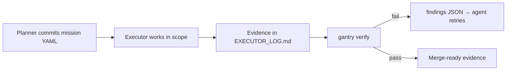

# How OpenGantry works

OpenGantry is the open-source `gantry` CLI. It runs in your repository and your CI, not in a hosted console. It adds three things to the gates you already have:

```
OpenGantry = scoped work order + shell gates + structured verify output
Executor   = the worker (Cursor, Claude Code, a CI bot, a human developer)
```

## The mission graph

Everything revolves around a **mission**: a YAML file under `.gitagent/missions/` that declares the intent, which paths may be edited, and which shell command must pass.



Three roles keep the duties separate:

| Role | Who | Does |
|------|-----|------|
| **Planner** | A human with an allowlisted Git email, or the Mission Architect in IDE chat drafting for them | Writes the mission with `gantry legislate` and commits it with an `[MSN-NNNN]` subject before any work starts |
| **Executor** | An agent or a developer | Edits only inside the mission scope and appends verbatim gate output to `EXECUTOR_LOG.md` |
| **Verifier** | `gantry verify`, separate from whoever edited | Runs the gate, checks the evidence and the Planner commit, and returns pass or structured `findings[]` |

## Terms in plain English

| Term | What it actually is |
|------|---------------------|
| **Mission** or **contract** | The mission YAML: allowed paths, forbidden paths and a required `gate_command`. It is a Git-locked work order, not design-by-contract in source code. |
| **Legislate** | Write that YAML with `gantry legislate` and lock it with a Planner commit before work starts |
| **TMVC** | The mission's edit scope: the `tmvc_roots` an executor may touch |
| **Forbidden zones** | Paths no executor may touch, such as the governance files themselves |
| **Governance** | Hooks and `gantry verify` that fail closed when scope or gates are violated, not a committee |
| **Verdict** | Pass or fail from shell gates plus evidence checks; on fail, a `findings[]` JSON envelope |

## What lives in your repository

| File | Role |
|------|------|
| `.gitagent/missions/MSN-NNNN.<slug>.yaml` | One mission: scope, `gate_command`, trace rows |
| `.gitagent/foreman/MANIFEST.json` | Skills, their edit roots, forbidden zones and risk tiers |
| `.gitagent/planner/RULES.md` | Governance rules every agent reads first |
| `EXECUTOR_LOG.md` | Verbatim gate output the verifier must find |
| `TARGET_ARCHITECTURE.yaml` | Perimeter rules: import layers for code, patterns for content |
| `AGENTS.md` | Entry point every agent tool reads: RULES and MANIFEST before acting |

## Why not just tests and CI?

You keep `npm test` and your CI. OpenGantry makes them usable when an agent runs the work:

| Who runs the work | What happens on failure |
|-------------------|-------------------------|
| A developer | Reads stderr, parses the stack trace, fixes the code |
| An agent with plain tests and CI | Misreads unstructured stderr, guesses at fixes and loops while someone senior babysits |
| An agent with OpenGantry | Same gates; `gantry context-feed --json` returns compact `findings[]` with the file, line and a hint |

| You already have | Still missing for agents | OpenGantry adds |
|------------------|--------------------------|-----------------|
| Tests and CI | Structured failure an agent can retry on | `findings[]` envelope |
| Pull request CI | A declared edit blast radius | Scope and forbidden zones in the mission |
| Code review | Proof the agent stayed in scope | A Planner commit plus `EXECUTOR_LOG.md` evidence in Git |

## Three phases, any domain

The graph is the same for TypeScript imports and for marketing copy. Domain adapters supply the rules:

| Phase | Command | Output |
|-------|---------|--------|
| Context ingestion | `gantry init --discover --domain code\|content` | `.gitagent/discovery-proposal.json` |
| Rules of engagement | `gantry blueprint --domain code\|content` | `ARCHITECTURE.md`, `TARGET_ARCHITECTURE.yaml`, `verification_plan.json` |
| Audit | `gantry verify --json` | Pass, or the `findings[]` envelope |

Details: [Perimeters and domain adapters](../concepts/perimeters.md).

## Where the cage fits

[The cage](../cage/index.md) needs none of this: `gantry cage check` fails a pull request whose commits change CI configs, secrets, git hooks or your own protected paths, `gantry cage watch` asks you about every change to those files on disk while you work, and the session cage restores them during scripted agent runs. Missions add what the cage cannot: scope checked on every write, work approved before it starts, and evidence a reviewer can check in CI.

Install the CLI and run the tutorial next: [Install](install.md).
